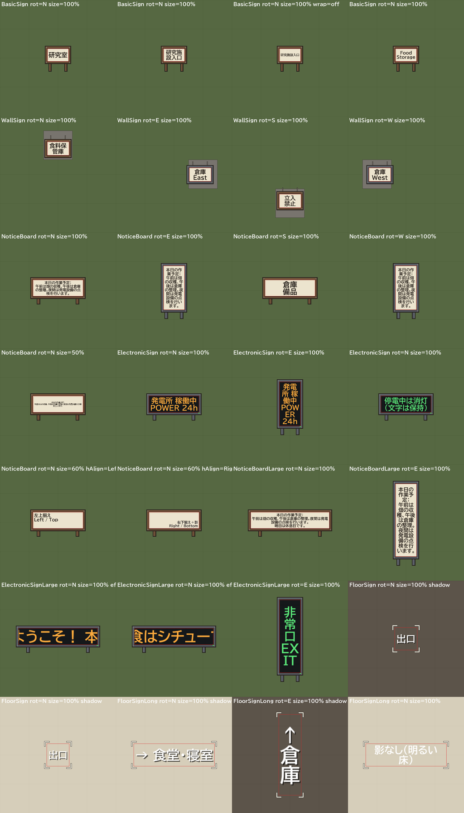

# Simple Sigh — RimWorld 1.7 用の自由入力看板 MOD

**Simple Sigh** は、コロニーに自由な文章を書ける看板を追加する MOD です。
木材・石材・金属で作る小さな看板から、壁掛け看板、複数行の掲示板、電気で光る電光掲示板まで用意しています。
日本語・英数字・記号を入力し、看板の表示面に文字を描画することを目的としています。

> **現在はテスト版です。** RimWorld 1.7 の参照 DLL に対するビルドと自動テストは実施していますが、
> **実際のゲーム内起動・日本語の表示・セーブ／ロード・電力動作は未検証**です。
> 既存セーブへ導入する場合は必ずバックアップしてください。

| 項目 | 内容 |
| --- | --- |
| MOD 名 | Simple Sigh |
| packageId | `pengin0503.simplesigh` |
| 対応ゲーム | RimWorld **1.7 のみ** |
| 前提 MOD | なし（Harmony も不要） |
| 同梱される DLL | `1.7/Assemblies/SimpleSigh.dll` |
| 同梱フォント | `Fonts/BIZUDPGothic-Bold.ttf`（BIZ UDPゴシック Bold、SIL Open Font License 1.1） |
| 開発・試用状況 | M1（基本看板）、M2（壁掛け・掲示板）、M3（電光掲示板）を実装。**ゲーム内は未確認** |

## ゲーム内でできること

### 4種類の看板

| 建築物 | サイズ | 主な機能 |
| --- | --- | --- |
| **看板** | 1×1 | 木・石・金属で作成。最大64文字（入力は1行）。長い文字は自動で折り返して大きく表示 |
| **壁掛け看板** | 1×1 | 壁に取り付ける小型看板。最大64文字（入力は1行）。長い文字は自動で折り返して大きく表示 |
| **掲示板** | 2×1 | 最大256文字・複数行。日本語の文字単位・英語の単語単位で自動折り返し |
| **電光掲示板** | 2×1 | 最大256文字・複数行。研究「電気」が必要。40W消費し、停電中は文字が消えて復電時に復元 |

**使用例：** 倉庫に「食料保管庫」、寝室に「来客用」、工房に「加工室」、入口に「立入禁止」などの文字を表示できます。

### 看板への文字入力

1. ゲーム内の建築メニューから看板を選び、建設します。素材が選べる看板は木材・石材・金属から選択できます。
2. 建設した看板をクリックし、**「文字を編集」**（Edit text）を押します。
3. 文字を入力し、文字色と大きさを設定して **OK** で確定します。**キャンセル**すると変更されません。
4. 掲示板・電光掲示板では改行を入力できます。画面に収まるよう文字を折り返し／縮小します。

看板の **「文字をコピー」／「文字を貼り付け」** で別の看板に設定を複製できます。
入力上限を超えた場合や使用できない制御文字は、黙って切り捨てずエラーとして扱います。

**日本語の表示（#4）：** 看板の文字は MOD に同梱した日本語フォント（BIZ UDPゴシック Bold）で描画します。
ゲームの表示言語に関係なく、漢字・ひらがな・カタカナ・英数字・記号を表示できます。
フォントにない文字（絵文字など）だけが `?` になります（保存された文章は変わりません）。
フォントを読み込めなかった場合はログにエラーを1回出し、ゲーム標準フォントで描画します（この場合は日本語が `?` になることがあります）。

**長い文字（#5）：** 1×1 の看板では、4文字以上の和文ラベルを行の長さをそろえて折り返し（例：「立入／禁止」）、
1行に詰めるより大きく表示します。1〜3文字は従来どおり1行で大きく表示し、英単語の途中では改行しません。
編集画面の「長い文字を自動で折り返して大きく表示する」で看板ごとに切り替えられます（初期値：オン）。
1×1 のマスはもともと小さいため、7文字以上の文章は拡大しないと読みにくくなります。
長い文には **2×1 の掲示板** をおすすめします。詳しい数値は [`docs/testing/legibility.md`](docs/testing/legibility.md) を参照してください。

**電光掲示板**は金属と工業用コンポーネント2個で建築する想定です。
電力が供給される間だけ文字と周囲の小さな光が点灯し、停電時には表示が消えます。
実際の明るさ・文字位置・壁への設置方法などはゲーム内での最終確認が必要です。

## インストール方法

### 方法A：GitHub Releases からZIPをダウンロード（推奨）

1. **[Releases（配布ページ）](https://github.com/pengin0503/rimworld-sigh/releases)** を開きます。リリースがまだ存在しない場合は、方法Bで試用できます。
2. リリースの **Assets** から `SimpleSigh-vX.Y.Z.zip` をダウンロードします。GitHub が自動で表示する **Source code (zip)** はMOD用のZIPではありません。
3. ZIPを**一度**展開します。中に `SimpleSigh` フォルダが1つあります。
4. この `SimpleSigh` フォルダを、RimWorldインストール先の `Mods` フォルダにコピーします。

例（Steam版Windowsの標準的な場所）：

```text
C:\Program Files (x86)\Steam\steamapps\common\RimWorld\Mods\SimpleSigh\
├─ About\About.xml
├─ 1.7\Assemblies\SimpleSigh.dll
├─ Defs\
├─ Fonts\BIZUDPGothic-Bold.ttf（看板用フォント）と BIZUDPGothic-OFL.txt
├─ Languages\
└─ Textures\
```

5. RimWorld **1.7** を起動して「MOD」メニューで **Simple Sigh** を有効にします。順序は Core の後に配置し、ゲームを再起動してください。
6. 新規セーブ（またはバックアップした既存セーブ）でまず基本看板から確認してください。

ZIPはMODに必要な**実行時ファイルだけ**を収録します。`Source`、`Tests`、`docs`、ゲーム本体のDLLは含みません。

### 方法B：PRで開発中のテスト版を入れる

GitHub Releaseが未作成でも、**[PR #3 のCI実行一覧](https://github.com/pengin0503/rimworld-sigh/pull/3/checks)** の成功した `Simple Sigh CI` を開くと、
`SimpleSigh-pr.zip` のテスト用Artifactをダウンロードできます。
展開後は方法Aと同じように `SimpleSigh` フォルダを `RimWorld/Mods/` に置いてください。
GitHubへのログインが必要な場合や、Artifactの保存期間（30日）によって入手できない場合があります。

**PRを作成・マージしただけではMODは自動的にゲームへインストールされません。**
上記のようにファイルをダウンロード・配置し、ゲーム内で有効化してください。

### インストールできない場合

- フォルダが `Mods/SimpleSigh/SimpleSigh/About/About.xml` のように二重になっていないか確認。
- RimWorld のバージョンが **1.7** であることを確認。
- `SimpleSigh.dll` が `Mods/SimpleSigh/1.7/Assemblies/` に存在することを確認。
- ゲーム内でエラーが出たらログと再現手順を添えて [Issues](https://github.com/pengin0503/rimworld-sigh/issues) に報告してください。
- セーブ破損を避けるため、検証中はバックアップ済みのセーブを使ってください。

### RimSort で「Mods with Missing Properties」と表示される場合

RimSort のこの警告は **Package ID** と **Publish Field ID（Steam Workshop の ID）** の2項目だけを調べます。
Simple Sigh の Package ID（`pengin0503.simplesigh`）は `About/About.xml` にあります。
Publish Field ID は `About/PublishedFileId.txt` から読まれ、**Steam Workshop に実際にアップロードしたときに RimWorld が作成する**ファイルです。
Workshop に出していないローカルMODでは警告が出るのが正常で、MODの動作には影響しません。

- 個人で使う場合：RimSort の警告ウィンドウで Simple Sigh を **Ignore** にすれば、以後表示されません。
- 架空のIDを書いたファイルを置かないでください。RimSort が別の Workshop アイテムとして扱い、更新確認などで誤動作します。

### Steam Workshop にアップロードする場合

`About` には Workshop 用の `Preview.png`（1280×720）、`ModIcon.png`、`modVersion` を用意してあります。

1. Releases のZIPを展開した `SimpleSigh` フォルダ（実行時ファイルだけを含む）を `RimWorld/Mods/` に置きます。リポジトリ全体をアップロードしないでください。
2. RimWorld の設定で開発モードを有効にし、MOD一覧で Simple Sigh を選んで「Steam Workshop にアップロード」を実行します。
3. アップロード後、RimWorld が `About/PublishedFileId.txt` を作成します。以後の更新ではこのファイルを残したまま再アップロードしてください（ZIPを作り直す場合もリリース用パッケージャはこのファイルを含めます）。

## 現在の検証状況

| 確認項目 | 現状 |
| --- | --- |
| XML・構造テスト | 実装済み（RimWorld Coreを必要とする追加確認は環境次第） |
| C#ユニットテスト（文章・描画レイアウト等） | 実装済み・CIあり |
| ZIPが必要なファイルのみを含むか | 専用の回帰テストとCIで確認 |
| 1.7参照アセンブリによるコンパイルと、同梱DLLがソースと一致するかの確認 | CIで実施（`Krafs.Rimworld.Ref` 1.7.4982、最新1.7でもコンパイル確認） |
| 同梱フォントのラスタライズ（FreeTypeとの比較・単体テスト） | 実施済み（オフライン） |
| ゲームDLLを読み込むスモークテスト | 開発環境のみ（実ゲームのDLLが必要） |
| **ゲーム本体でのプレイ** | **NOT RUN（未確認）** |



*上の画像はオフラインのプレビューです。MOD自身のレイアウト計算と、同梱フォントから作ったグリフアトラスを使って描いていますが、RimWorld内のスクリーンショットではありません。*

## 開発・ビルド・配布の仕組み

開発環境には .NET 10 SDK と Python 3 が必要です。
MOD 本体は NuGet の参照専用パッケージ `Krafs.Rimworld.Ref`（ゲームのシグネチャのみ。Ludeon が参照目的での利用を許可）に対してコンパイルするため、
ゲーム本体の DLL がなくてもビルドできます。固定している 1.7.4982-unstable は非公開の参照 DLL と同じビルドで、どちらに対してビルドしても同一の `SimpleSigh.dll` になります。
ゲーム DLL はリポジトリや配布 ZIP には含めません。実ゲームの DLL を使う場合は `RIMWORLD_REFERENCE_DIR` を指定します（スモークテストはその場合のみ実行）。

```bash
tools/verify.sh            # 構造・パッケージ・単体テスト、Releaseビルド、同梱DLLとの一致確認
python -m unittest discover -s Tests/PackagingTests -v
python tools/package_release.py --version v0.1.0-test --output dist/SimpleSigh-v0.1.0-test.zip
```

`.github/workflows/ci.yml` はPRへの更新時にXMLテスト・C#単体テスト・MOD本体のビルド（コミット済みDLLとの一致確認を含む）・ZIPパッケージングテストを実行し、成功時は試用ZIPをArtifactとして添付します。
ソースを変更したら `tools/verify.sh` で `1.7/Assemblies/SimpleSigh.dll` を再ビルドし、一緒にコミットしてください。

`.github/workflows/release.yml` は **mainに含まれるコミットへ`v`で始まるタグをpushした場合のみ**、
再度テスト・ZIP作成を行い、GitHub ReleaseのAssetsに直接ダウンロードできるZIPをアップロードします。
ゲーム内テストが終わるまでは**プレリリース**として公開します。単なるPRのマージではReleaseは作られません。

例（ゲーム内テスト未完了のテスト版タグを切る場合。**mainへマージ後**）：

```bash
git checkout main
git pull --ff-only
git tag v0.1.0-test.1
git push origin v0.1.0-test.1
```

ゲーム内での確認は以下のチェックリストを参照してください：
`docs/testing/m1-manual-checklist.md`、
`docs/testing/m2-manual-checklist.md`、
`docs/testing/m3-manual-checklist.md`、
`docs/testing/japanese-and-legibility-checklist.md`（日本語表示・長い文字）。

オフラインプレビューの再生成：`python3 tools/preview/render_preview.py docs/images/offline-layout-preview.png`

その他の設計・実装判断は `docs/development/implementation-log.md` に記録されています。

## 制限・未検証事項

- 同梱フォントによる日本語描画はオフラインで検証済みですが、ゲーム内（Waylith のテクスチャ転送・シェーダー）での表示は未確認です。
- 1×1 の看板は表示面が約 0.72×0.44 マスしかなく、長い文はズームしないと読めません（`docs/testing/legibility.md`）。
- 掲示板・電光掲示板（複数行）は従来どおり、大きく表示するために長い英単語を途中で折り返すことがあります。
- 文字の向き・回転・照明・霧・UIスケール・電光掲示板の復電動作は実機確認が必要です。
- 絵文字・複雑な書記体系の完全対応、LEDスクロール、3×1サイズの掲示板は未実装です。
- 複数選択した看板の一括編集、長文入力欄のスクロールバーは未対応です。
- 現時点で、既存セーブからMODを削除した場合の互換性は保証しません。

## ライセンス・クレジット

- 看板用フォント：**BIZ UDPゴシック**（Copyright 2022 The BIZ UDGothic Project Authors、株式会社モリサワ）。
  [SIL Open Font License 1.1](Fonts/BIZUDPGothic-OFL.txt) に基づき、改変せずに同梱しています。
  入手元：[google/fonts `ofl/bizudpgothic`](https://github.com/google/fonts/tree/main/ofl/bizudpgothic)。
