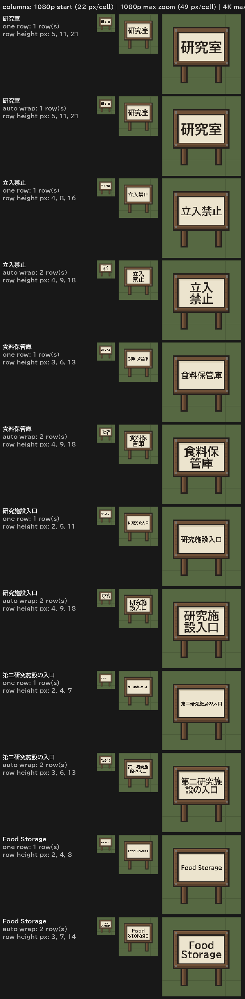

# Sign text legibility (issue #5)

What a sign can show legibly, measured with the mod's own layout code and the bundled sign font.
**These are offline calculations, not in-game screenshots.** In-game confirmation is listed in
[`japanese-and-legibility-checklist.md`](japanese-and-legibility-checklist.md).

## How the numbers were obtained

- Layout: `SignTextLayout.Build` (the code the game uses) with the panels, paddings and draw sizes
  from `Defs/ThingDefs`, glyph metrics from `Fonts/BIZUDPGothic-Bold.ttf` rasterized by `GlyphAtlas`.
- "Line height" is the height of one text row in map cells (one cell = one tile).
- Pixels per cell: RimWorld draws a cell at `screen height / (2 × camera root size)` pixels.
  Root size 24 is `CameraDriver.StartingSize` in the 1.7 reference assemblies (1080p: 22 px per cell).
  The zoom-in limit of 11 (1080p: 49 px, 4K: 98 px per cell) is the vanilla value of earlier
  versions and was **not verified for 1.7**.
- Rule of thumb: kanji need roughly 12 px or more per row to be read; kana and Latin a little less.

## 1×1 standing sign (64 characters, single-line input)

Row counts and line heights. Pixel values are for 1080p start / 1080p fully zoomed in / 4K fully zoomed in.

| Text | Chars | One row (v0.1.0-test.1) | Automatic wrapping (now) | 2×1 notice board |
|---|---:|---|---|---|
| 研究室 | 3 | 1 row, 0.216 cell = 5 / 11 / 21 px | 1 row, 0.216 cell = 5 / 11 / 21 px | 1 row, 0.495 cell = 11 / 24 / 49 px |
| 立入禁止 | 4 | 1 row, 0.162 cell = 4 / 8 / 16 px | 2 rows, 0.184 cell = 4 / 9 / 18 px | 1 row, 0.413 cell = 9 / 20 / 41 px |
| 食料保管庫 | 5 | 1 row, 0.130 cell = 3 / 6 / 13 px | 2 rows, 0.184 cell = 4 / 9 / 18 px | 1 row, 0.330 cell = 7 / 16 / 32 px |
| 研究施設入口 | 6 | 1 row, 0.108 cell = 2 / 5 / 11 px | 2 rows, 0.184 cell = 4 / 9 / 18 px | 1 row, 0.275 cell = 6 / 14 / 27 px |
| 第二研究施設の入口 | 9 | 1 row, 0.072 cell = 2 / 4 / 7 px | 2 rows, 0.130 cell = 3 / 6 / 13 px | 2 rows, 0.248 cell = 6 / 12 / 24 px |
| 研究施設入口・食料保管庫 | 12 | 1 row, 0.056 cell = 1 / 3 / 6 px | 3 rows, 0.123 cell = 3 / 6 / 12 px | 2 rows, 0.248 cell = 6 / 12 / 24 px |
| 32 kanji | 32 | 1 row, 0.020 cell = 0 / 1 / 2 px | 4 rows, 0.081 cell = 2 / 4 / 8 px | 3 rows, 0.150 cell = 3 / 7 / 15 px |
| 64 kanji | 64 | 1 row, 0.018 cell = 0 / 1 / 2 px | 6 rows, 0.059 cell = 1 / 3 / 6 px | 4 rows, 0.103 cell = 2 / 5 / 10 px |
| Food Storage | 12 | 1 row, 0.086 cell = 2 / 4 / 8 px | 2 rows, 0.146 cell = 3 / 7 / 14 px | 2 rows, 0.248 cell = 6 / 12 / 24 px |

The wall sign (1×1) is about 5% larger than the standing sign; the regression floors are in
`Tests/SimpleSigh.Text.Tests/SignLegibilityTests.cs`.

## What this means

- **Automatic wrapping** (on by default for 1×1 signs, switchable per sign in the editor) shows labels of
  4 or more Japanese characters on balanced rows ("立入" / "禁止"), 1.1–4× larger than the old single
  row. 1–3 characters keep their single large row. Latin words are never split ("Refrigerator" stays one
  row). The saved text is not changed.
- **Physical limit of a 1×1 tile.** The panel of the 1×1 signs is about 0.72 × 0.44 cells. At the 1080p
  starting zoom no label of any length reaches 12 px; fully zoomed in on 1080p, only about three kanji
  in one row do. Labels of 4–6 kanji reach about 9 px at 1080p (18 px at 4K) and need zooming in.
  **A 1×1 sign cannot make longer text legible at normal zoom** — no layout can, the tile is too small.
- **Recommendation:** use the 2×1 notice board (or the electronic sign) for more than about six
  characters. The editor shows this hint for single-line signs from seven characters on.
- Not changed by this fix: a larger panel on the 1×1 art would help further but changes the textures.
